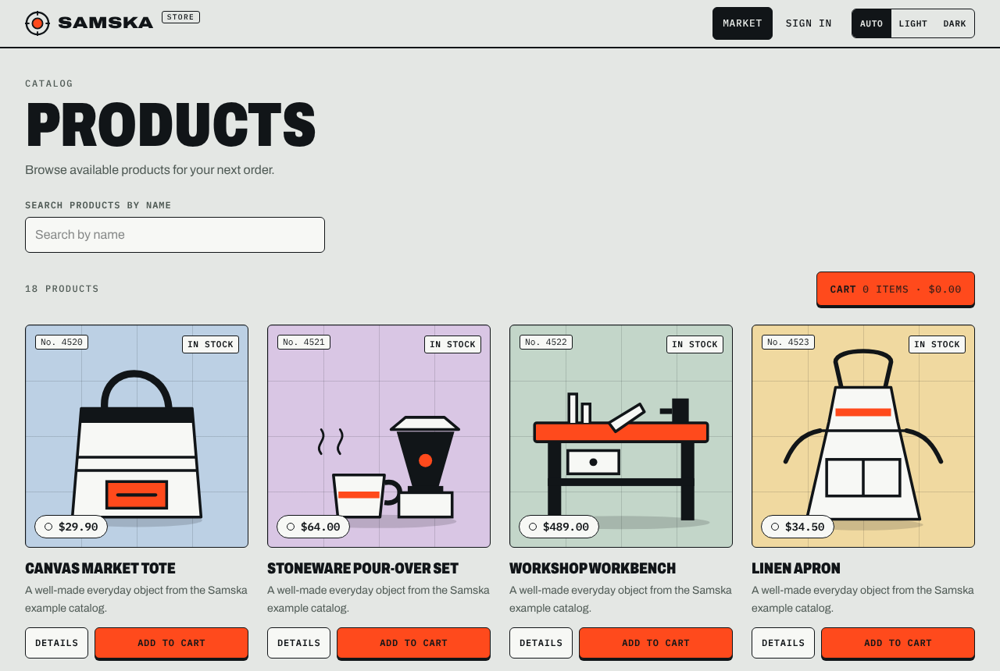
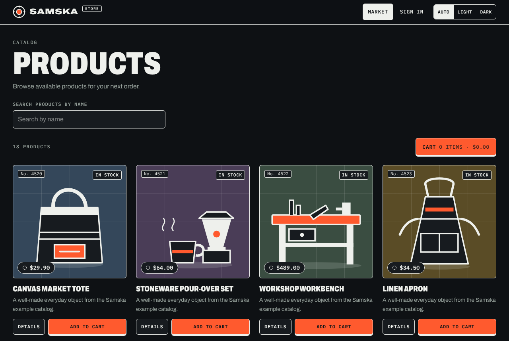
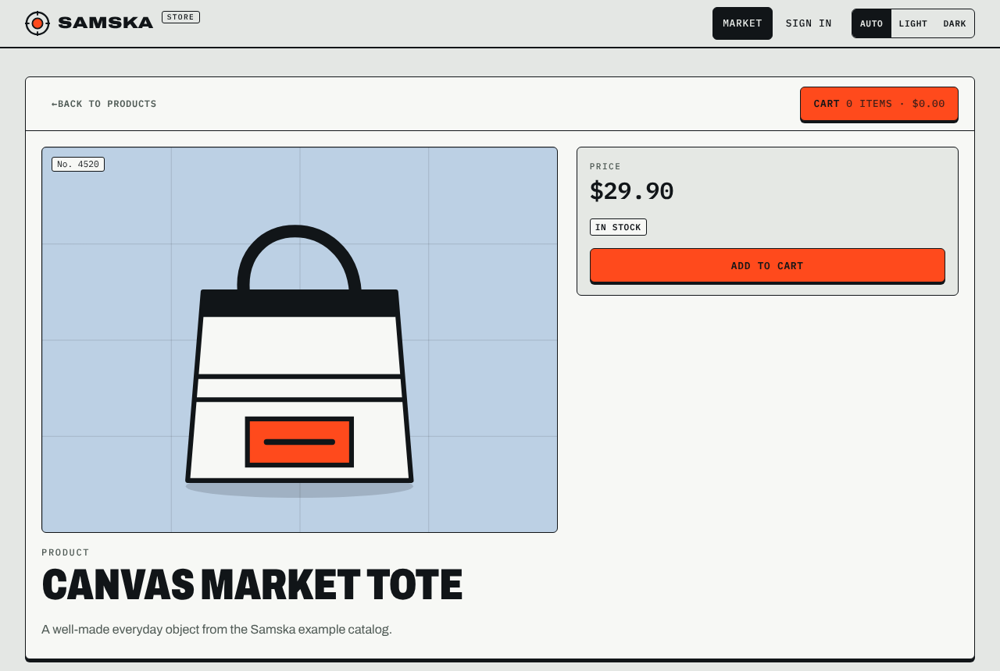
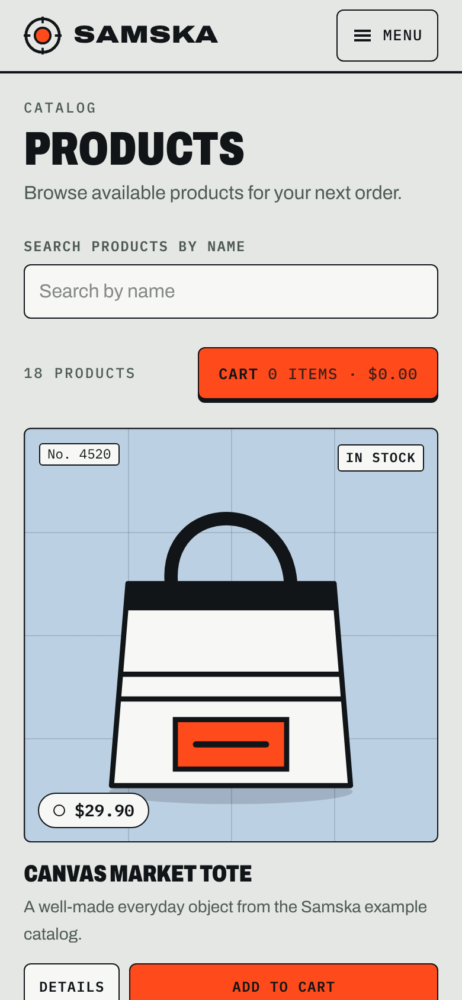
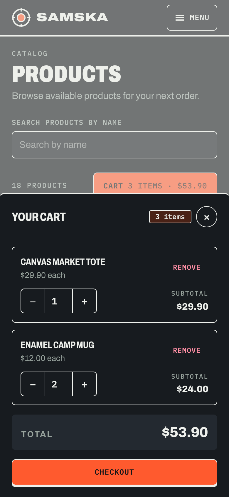
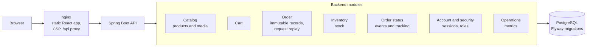

# Samska Store

[](https://github.com/Samska/samska-sandbox/actions/workflows/ci.yml)
[](LICENSE)

A personal storefront built end to end as an engineering practice project:
a React and TypeScript web app over a Spring Boot modular monolith with
PostgreSQL, a designed visual identity, automated tests at every layer, and a
containerized deployment on Railway.

**Live:** <https://store.samska.dev>

Visitors can browse the catalog and open any product. The store has a single
user, its owner, who signs in to shop and to run the Admin area. There is no
sign-up, every Order is approved at checkout, and nothing is charged. All data
is synthetic.

The repository is called `samska-sandbox` because it is also a place to
practice software architecture, quality, security, delivery, and operations
with documented decisions. The source is licensed under the
[Apache License 2.0](LICENSE) and is non-commercial.

## Screenshots

| Desktop, light | Desktop, dark |
| --- | --- |
|  |  |

| Product detail | Mobile, light | Mobile, dark with the Cart open |
| --- | --- | --- |
|  |  |  |

_Captured from the real web app with example catalog data._

## What It Does

- **Market.** Browse a fixed example catalog of 18 products with original
  "Bench" illustrations, search by name, open a product, and see stock states
  such as "2 left" and "Sold out".
- **Cart and Checkout.** A Cart drawer and an editable Checkout with a single
  "Place order" step. A repeated request returns the same Order, so a retry
  after an unconfirmed response never places two.
- **Orders.** Order history and tracking. The owner sets each Order's status
  by hand in Admin.
- **Admin.** A separate area for products (create, edit, delete, image upload,
  stock) and orders, plus an Operations screen with request metrics.
- **Light and dark.** An Auto, Light and Dark theme switch, responsive from
  390 px up, with keyboard and focus handling covered by tests.

## Tech Stack

| Area | Technology |
| --- | --- |
| Backend | Java 25, Spring Boot 4.1, Maven Wrapper, JDBC, Flyway |
| Frontend | React 19, TypeScript, Vite, Tailwind CSS v4 (no router or state library) |
| Database | PostgreSQL 18 |
| Testing | JUnit, Spring MockMvc, Testcontainers, Vitest, React Testing Library, Playwright (Chromium) |
| Delivery | Docker images, nginx, Railway, GitHub Actions |
| Security | CodeQL, GitGuardian, secret scanning, rate limiting, security headers, CSRF protection |

## Architecture

The backend is a modular monolith: one deployable with explicit business
boundaries ([ADR 0001](docs/adr/0001-adopt-modular-monolith.md)).



Key decisions, each with an ADR in [docs/adr](docs/adr/README.md):

- Orders copy the reviewed Cart snapshot, take stock and empty the Cart in one
  transaction, and are idempotent by a client-generated request ID.
- Sessions are server-side with CSRF protection; the Admin API requires the
  administrator role on the server, not only in the interface.
- The web image configures nginx at start-up from environment variables, so the
  same image runs locally, on a VPS and on Railway
  ([ADR 0020](docs/adr/0020-run-on-railway-with-environment-driven-web-image.md)).

More detail is in [Architecture](docs/ARCHITECTURE.md) and the
[Threat Model](docs/THREAT-MODEL.md).

## Run Locally

Requirements: Java 25, Node 24.20.0, and Docker for PostgreSQL.

```bash
cp .env.example .env
# set POSTGRES_PASSWORD in .env
export POSTGRES_PASSWORD='the-same-disposable-value'
docker compose up -d --wait
cd web && npm ci --ignore-scripts && cd ..
./scripts/dev.sh
```

The launcher starts the backend on port 8080 and Vite on port 5173. See
[Local Development](docs/LOCAL-DEVELOPMENT.md) for the owner account, sample
products, troubleshooting and shutdown.

## Tests And CI

```bash
cd backend && ./mvnw verify        # unit, API and PostgreSQL integration tests
cd web && npm run typecheck && npm test
cd web && npm run test:e2e         # Playwright, starts its own servers
```

Every pull request runs independent CI jobs (repository validation,
container images, backend, frontend, and browser E2E) with structured test
reports, next to CodeQL and GitGuardian. The strategy and what each layer does
and does not prove are in [Testing](docs/TESTING.md).

## Deployment

The public site runs on Railway as three services built from this repository:
`web` (nginx and the React app), `backend` and PostgreSQL. Only `web` is
public; the backend is reachable over Railway's private network. The same
images also run on a VPS with Docker Compose and Caddy. Steps, variables and
the private-first mode are in [Deployment](docs/DEPLOYMENT.md).

## Documentation

- [Product](docs/PRODUCT.md), [Roadmap](docs/ROADMAP.md) and [release notes](docs/releases/v1.0.0.md)
- [Architecture](docs/ARCHITECTURE.md) and [ADRs](docs/adr/README.md)
- [Design system and prototypes](docs/design/samska-store/README.md)
- [Testing](docs/TESTING.md), [Security](docs/SECURITY.md) and [Threat Model](docs/THREAT-MODEL.md)
- [Local Development](docs/LOCAL-DEVELOPMENT.md), [Deployment](docs/DEPLOYMENT.md) and [Releasing](docs/RELEASING.md)
- [Engineering Learning Journal](docs/learning/README.md)
- [Contributing](CONTRIBUTING.md) and [Security reporting](SECURITY.md)

## How The Project Is Run

Work is tracked as `SS-NNN` Issues in the
[Samska Sandbox Project](https://github.com/users/Samska/projects/1) and lands
through short-lived branches and squash-merged pull requests. Each pull
request records what was verified by the author, by a human and by CI.
Interface work starts from an owner-approved HTML prototype under
[docs/design](docs/design/samska-store/README.md).

AI coding agents are used as implementation tools under the repository rules in
[AGENTS.md](AGENTS.md) and [AI Engineering Governance](docs/AI-GOVERNANCE.md).
The owner decides scope, architecture and merges, and reviews every change.
Project state at a glance: [PROJECT_HANDOFF.md](PROJECT_HANDOFF.md).
